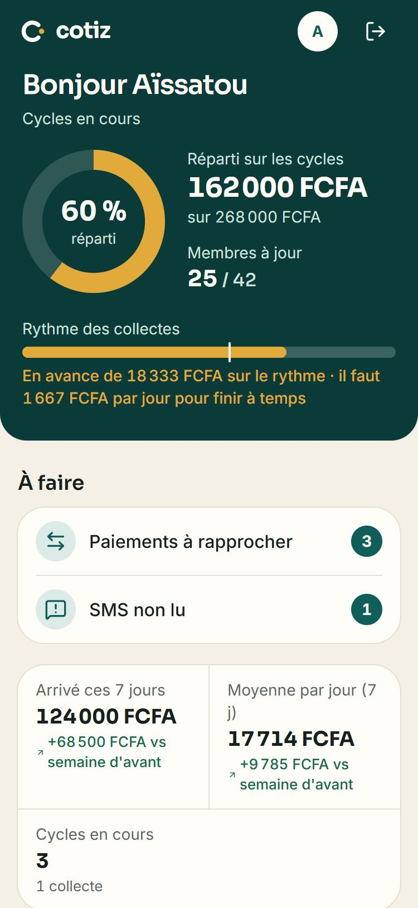
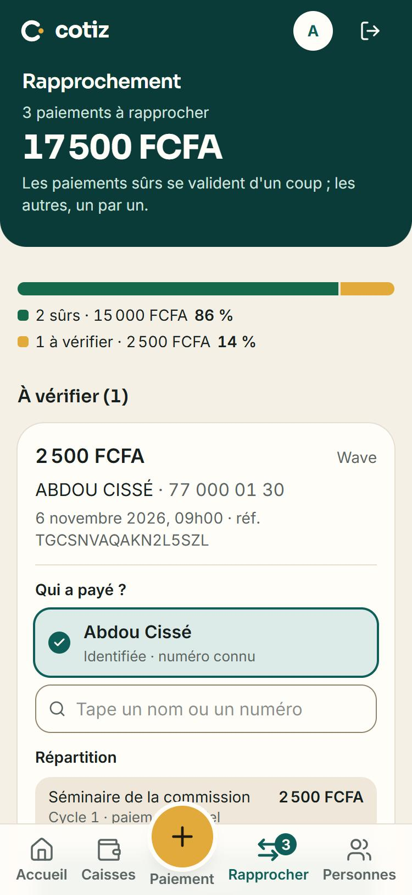
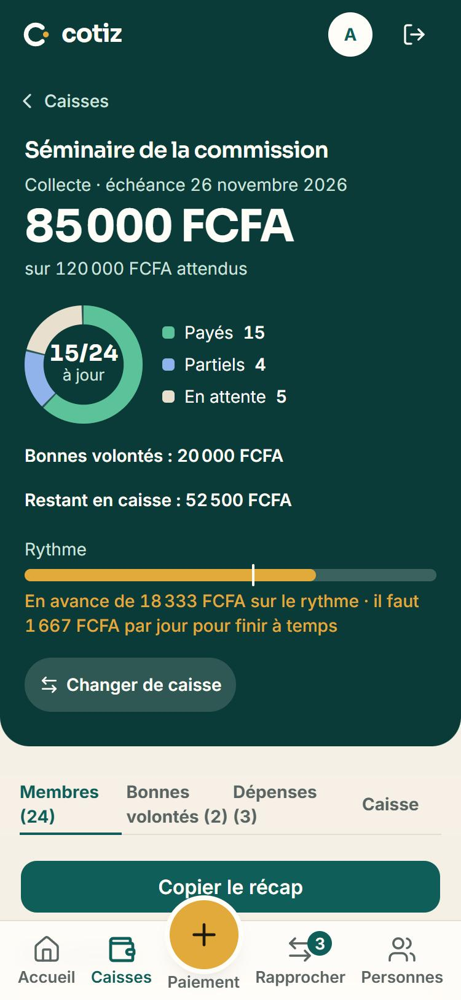
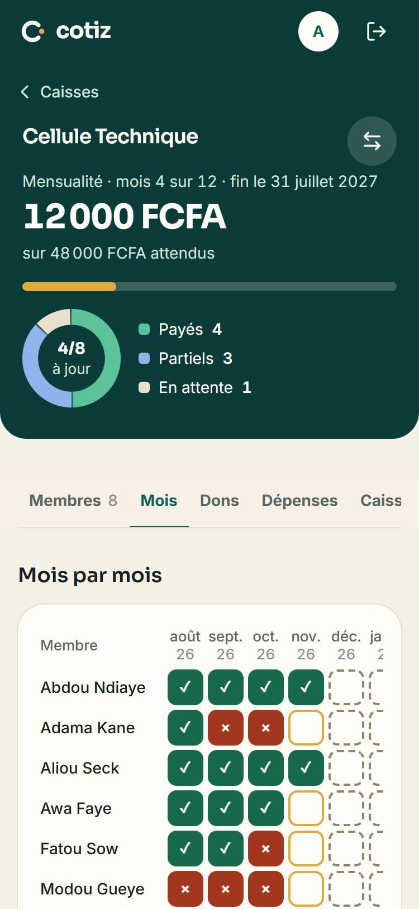
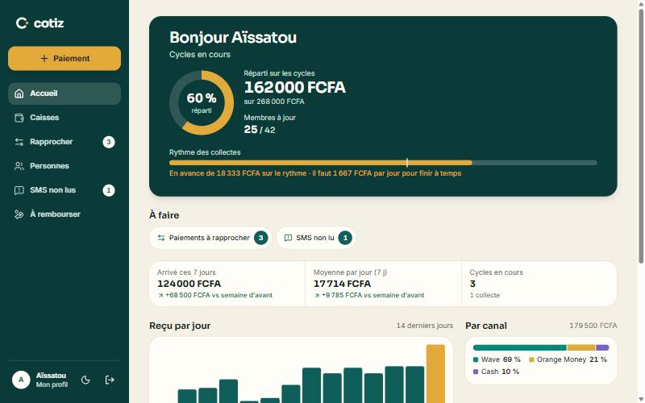
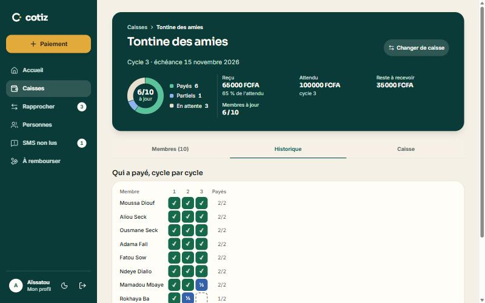

# Cotiz

*[Version française](README.md)*

**A mobile-first web app for the treasurer of community savings groups (tontines) in Senegal.**
She records every payment the moment it arrives, then reconciles everything in a few minutes in the evening: who paid, who still owes, and a one-tap WhatsApp reminder for the others.

Cotiz is in real use: the treasurer it was built with manages her groups with it, including a 70-member fundraiser.

## Screenshots

*Invented demo data, on a local copy of the app.*

| Home | Evening reconciliation | Fundraiser follow-up | Monthly contributions |
| --- | --- | --- | --- |
|  |  |  |  |

On a computer, a sidebar replaces the bottom tab bar:

 

## The problem

Every member pays into the treasurer's single Wave account (Wave is the main mobile money service in Senegal), sometimes in cash or through Orange Money. Before Cotiz, she matched payment SMS messages to a Word table by hand. One payment can cover several groups or several months, members use different phone numbers, and the same money can easily be counted twice.

Cotiz models this explicitly: a **Payment** is split into **Allocations** across one or more **Dues** (`Echeance`). The app proposes who paid and where the money goes; the treasurer always confirms.

## Features

- **Capture in seconds**: paste a Wave SMS, or enter a payment by hand (Wave without SMS, Orange Money, cash). Duplicates are detected; unreadable SMS are kept aside instead of being lost. The account balance in the SMS is stripped before anything is parsed or stored.
- **Evening reconciliation**: the person and the split are proposed; payments with nothing to decide (known phone number, exact amount) can be confirmed in one tap. A reconciliation can be undone.
- **Four kinds of groups**: rotating tontines (cycles, payout order, history), one-off fundraisers (expenses, extra donations), monthly contributions (month-by-month status, late or ahead), and money kept on someone's behalf (deposits, withdrawals, running balance).
- **Import from Word or Excel**: paste the existing member list, preview every line, nothing is written before confirmation; amounts already paid become reconciled payments, without ever counting them twice on a re-import.
- **Follow-up**: paid / partial / pending per member, totals per sub-group, WhatsApp reminders with a pre-filled message, a summary to paste in the group chat.
- **Audit log** of every change to money, readable on each payment's page.

The interface is French-only: the people who use it speak French.

## Tech stack

- **Next.js 16** (App Router, Server Actions, Cache Components), **React 19**, **TypeScript** (strict)
- **PostgreSQL** on Supabase, with **Prisma 7**; Supabase Auth for sign-in
- **Tailwind CSS 4** and shadcn/ui; hand-made SVG charts (no chart library)
- **Zod** for every input, **Vitest** for tests, **GitHub Actions** for CI, deployed on **Vercel**

## Engineering decisions worth a look

Real money is involved, so most of the work went into making mistakes impossible rather than unlikely.

- **Tenant isolation**: every query is scoped to the signed-in user (`ownerId`), and an id coming from the browser is never trusted without that check. Row Level Security is enabled on every table, so Supabase's public REST API returns nothing. An integration test signs in as two users and checks that neither can read or change the other's data.
- **Concurrent money operations**: confirming the same payment twice at the same time (double tap, two tabs) cannot allocate more than its amount. Mutations lock the affected rows at the start of the transaction before re-reading what is still owed, and a test fires them in parallel to prove it.
- **Audit trail**: every change to a payment, allocation, donation, expense or account movement is logged in the same transaction. A static test scans the code and fails if a new mutation forgets to log.
- **Protected history**: deferred foreign keys refuse to delete a group, person or cycle that still carries money, while deleting a whole account stays possible.
- **Pure business logic**: SMS parsing, payment matching and the monthly-contribution rules are pure functions with no database access. The matching runs both in the browser (instant proposals) and on the server, which re-checks everything before writing.
- **Integer money**: amounts are integers in CFA francs (no cents), validated against a maximum; `5000.00` is read as 5 000 and `1.5` is rejected, never silently turned into 15.

## Quality

- **Over 600 tests**: unit tests for the parser, matching, imports, dates and statistics, plus integration tests against a local Postgres (isolation, concurrency, imports, accounts, login rate limiting).
- **CI on every push**: lint, type check, unit tests, a disposable local Supabase, migrations, integration tests and a production build. No production secret is ever used.
- **Security**: strict Content Security Policy and security headers, HttpOnly session cookies, login attempts limited per address and per network, errors logged without personal data.
- **Operations**: verified backups (a script restores the latest dump into a temporary database and compares row counts) and a documented release order: back up, migrate, then deploy.

## How it was built

I built Cotiz with an AI coding agent (Claude Code), under rules I wrote for it (`CLAUDE.md`, kept out of this repository): summarise the plan and wait for my approval before writing code, one commit per phase, never invent a business rule (ask instead), and after each phase explain the main technical choices and ask me questions to check that I understood them. Every business decision was made with the treasurer and is recorded in the specification ([`CAHIER_DES_CHARGES.md`](CAHIER_DES_CHARGES.md), in French), along with several rounds of security, data and interface audits.

## Run it locally

Requirements: Node.js 24 and Docker Desktop (for the local Supabase).

```bash
npm install
npm run supabase:start
```

Copy `.env.example` to `.env` and fill in the keys printed by `npx supabase status`, then:

```bash
npx prisma migrate deploy
npm run db:seed
npm run dev
```

Sign in with the demo account defined in `.env`. The seed refuses to run against anything other than a local database.

| Command | Purpose |
| --- | --- |
| `npm test` | Unit tests (no database needed) |
| `npm run test:isolation` | Integration tests (local Supabase running) |
| `npm run lint` / `npm run build` | Lint / production build |

## Project structure

| Folder | Contents |
| --- | --- |
| `app/(prive)/` | Signed-in pages: home, groups, people, capture, reconciliation, refunds… |
| `app/actions/` | Server Actions: auth check, Zod validation, `ownerId` filter, transaction, row locks, audit log |
| `lib/parsers/`, `lib/capture/` | Wave SMS parser, duplicate detection |
| `lib/matching/` | Who paid and how to split it (pure, also runs in the browser) |
| `lib/import/` | Pasted list parsing and analysis |
| `lib/donnees/` | Database reads, always scoped to the signed-in user |
| `prisma/` | Schema, hand-completed SQL migrations (RLS, deferred keys, data backfills), seed |
| `tests/` | Unit and integration tests, with invented data in the real SMS and Word formats |

## Status

Version 0 is in production and in daily use. Next steps, decided with the treasurer: run a full cycle without the paper notebook, then version 1 (starting with reading Orange Money SMS).

## License

[MIT](LICENSE) © 2026 Ndeye Penda Sarr
